# TP Netsim : Simulateur Réseau

## Objectifs du TP

A la fin de ce TP, vous serez capable de :

- Configurer des adresses IP statiques sur des machines
- Calculer une adresse réseau à partir d'une adresse IP et d'un masque de sous-réseau
- Comprendre pourquoi deux machines d'un même réseau peuvent communiquer entre elles
- Mettre en place un serveur DHCP pour attribuer automatiquement des adresses IP
- Configurer un routeur pour interconnecter deux sous-réseaux différents
- Mettre en place un serveur DNS pour résoudre des noms de domaine en adresses IP
- Configurer un serveur web et publier des pages HTML accessibles par nom de domaine
- Utiliser les commandes `ping` et `traceroute` pour tester la connectivité réseau

## Prérequis

- Notions de base sur les réseaux informatiques (adresse IP, masque de sous-réseau)
- Opération AND (ET logique) bit à bit
- Navigateur web récent (Chrome, Firefox, Edge) sur un ordinateur

## Présentation du simulateur Netsim

Netsim est un simulateur réseau en ligne qui permet de construire et tester des topologies réseau simples directement dans votre navigateur.

**Accès au simulateur :** [https://fabrice1618.github.io/netsim/](https://fabrice1618.github.io/netsim/)

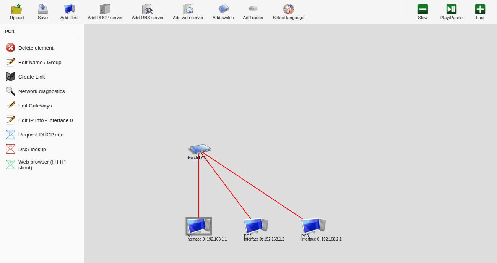

L'écran est organisé en trois zones :

- **la barre du haut** : à gauche, sauvegarder et ajouter des éléments ; à droite, contrôler l'animation ;
- **la zone de travail** (au centre) : les éléments et les câbles ;
- **le panneau de gauche** : les actions possibles sur l'élément sélectionné.

### Eléments disponibles dans le simulateur

| Bouton | Elément | Description |
|--------|---------|-------------|
| **Add Host** | Ordinateur | Un ordinateur avec une interface réseau (Interface 0) |
| **Add switch** | Switch | Un commutateur réseau (8 ports) qui relie plusieurs machines d'un même réseau local |
| **Add router** | Routeur | Un routeur avec deux interfaces (interface 0 et interface 1) pour interconnecter deux réseaux |
| **Add DHCP server** | Serveur DHCP | Attribue automatiquement des adresses IP aux machines |
| **Add DNS server** | Serveur DNS | Traduit les noms de domaine en adresses IP |
| **Add web server** | Serveur web | Publie des pages web (HTTP) |

### Comment utiliser le simulateur

1. **Ajouter un élément** : cliquer sur le bouton de l'élément dans la barre du haut. Il apparaît en haut de la zone de travail.
2. **Déplacer un élément** : le faire glisser avec la souris. Laisser libre le haut de la zone de travail : c'est là qu'apparaissent les nouveaux éléments.
3. **Sélectionner un élément** : cliquer dessus (clic gauche). Ses actions s'affichent dans le panneau de gauche.
4. **Renommer un élément** : le sélectionner, puis **Edit Name / Group**.
5. **Connecter deux éléments** : sélectionner le premier, cliquer sur **Create Link**, puis sur le second élément. Une fenêtre s'ouvre : cocher **une interface de chaque côté**, puis **Save**. Les interfaces déjà utilisées sont grisées.

   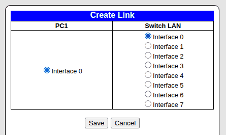

6. **Configurer un élément** : le sélectionner, puis choisir une action dans le panneau de gauche.

   | Action | Rôle |
   |--------|------|
   | **Edit IP Info - Interface 0** | Configurer l'adresse IP, le masque et les serveurs DNS |
   | **Edit Gateways** | Configurer la passerelle par défaut et les routes |
   | **Network diagnostics** | Lancer un **Ping** ou un **Trace Route** vers une adresse ou un nom |
   | **Request DHCP info** | Demander une configuration au serveur DHCP (ordinateurs) |
   | **DNS lookup** | Demander l'adresse IP d'un nom au serveur DNS (ordinateurs) |
   | **Web browser (HTTP client)** | Ouvrir une page web (ordinateurs) |
   | **Edit DHCP server info** | Configurer le serveur DHCP |
   | **DNS server config** | Configurer la table du serveur DNS |
   | **Edit HTTP server info** | Configurer les sites du serveur web |
   | **Edit NAT table** | Configurer le NAT du routeur |

7. **Supprimer un élément ou un câble** : cliquer dessus, puis **Delete element**, et confirmer.
8. **Contrôler l'animation** (en haut à droite) : **Slow** ralentit, **Fast** accélère, **Play/Pause** arrête ou relance. En pause, on peut lire sur chaque enveloppe la source (*Src*), la destination (*Dst*) et le type du message.

> **Attention aux tableaux** : dans les fenêtres qui contiennent un tableau (passerelles, DNS, sites web), une ligne saisie n'est prise en compte qu'après un clic sur **[+]** (*Add*), **puis** sur **Save**.

> **Conseil** : Si un ping n'obtient pas de réponse, vérifier d'abord que l'animation n'est pas en pause (bouton **Play/Pause**).

### Sauvegarder son travail

Le travail est perdu si la page est rechargée. A la fin de chaque partie, cliquer sur **Save**, choisir un nom de fichier (par exemple `partie1.json`), puis **Download**. Pour reprendre : recharger la page, puis **Upload**.

> **Attention** : la sauvegarde ne contient ni les adresses reçues par DHCP, ni les noms déjà résolus. Après un **Upload**, refaire **Request DHCP info** sur les ordinateurs en DHCP, puis les **DNS lookup**.

---

## Rappels : Concepts réseau utilisés

### Adresse IP et masque de sous-réseau

Une **adresse IP** (version 4) est composée de 4 octets séparés par des points (ex: `192.168.1.1`). Elle identifie de manière unique une machine sur un réseau.

Le **masque de sous-réseau** (ex: `255.255.255.0`) détermine quelle partie de l'adresse IP représente le réseau et quelle partie représente la machine (hôte). On le note aussi par son nombre de bits à 1 : `255.255.255.0` s'écrit `/24`.

### Calcul de l'adresse réseau

L'adresse réseau se calcule en effectuant un **ET logique** (AND) bit à bit entre l'adresse IP et le masque :

```
Exemple :
  Adresse IP :   192.168.1.25    → 11000000.10101000.00000001.00011001
  Masque :       255.255.255.0   → 11111111.11111111.11111111.00000000
  ─────────────────────────────────────────────────────────────────────
  Adresse réseau: 192.168.1.0    → 11000000.10101000.00000001.00000000
```

> **Règle fondamentale** : Deux machines peuvent communiquer directement (sans routeur) **uniquement si elles appartiennent au même réseau**, c'est-à-dire si leurs adresses réseau sont identiques.

### DHCP (Dynamic Host Configuration Protocol)

Le protocole DHCP permet d'attribuer **automatiquement** des adresses IP aux machines d'un réseau. Le processus se déroule en 4 étapes (DORA) :

1. **Discover** : La machine envoie une requête de diffusion pour trouver un serveur DHCP
2. **Offer** : Le serveur DHCP propose une adresse IP disponible
3. **Request** : La machine demande à utiliser l'adresse proposée
4. **Acknowledge** : Le serveur confirme l'attribution (le *bail*) et sa durée

> **Simplification de Netsim** : le simulateur ne montre que deux messages, `DHCP: request` et `DHCP: offer`.

### Routeur et passerelle par défaut

Un **routeur** relie deux réseaux différents. Il possède une interface dans chaque réseau. Lorsqu'une machine veut communiquer avec une machine d'un autre réseau, elle envoie le paquet à sa **passerelle par défaut** (gateway), qui est l'adresse du routeur dans son réseau.

### DNS (Domain Name System)

Un serveur **DNS** traduit un nom de domaine (ex: `www.netsim.lan`) en adresse IP. La machine garde la réponse en mémoire dans son **cache DNS**.

---

## Partie 1 - Configuration IP statique

### Objectif

Comprendre l'adressage IP statique et le rôle de l'adresse réseau dans la communication entre machines.

### Topologie réseau

```
    ┌──────────────────────────────────┐
    │            Switch LAN            │
    └──┬──────────────┬────────────┬───┘
       │              │            │
       │              │            │
  ┌────┴─────┐  ┌─────┴────┐  ┌────┴─────┐
  │   PC1    │  │   PC2    │  │   PC3    │
  │192.168.  │  │192.168.  │  │192.168.  │
  │  1.1/24  │  │  1.2/24  │  │  2.1/24  │
  └──────────┘  └──────────┘  └──────────┘
```

### Instructions

**Etape 1 :** Ajouter les éléments suivants dans le simulateur, puis les renommer (**Edit Name / Group**) :

- 1 switch : `Switch LAN`
- 3 ordinateurs (**Add Host**) : `PC1`, `PC2` et `PC3`

Connecter chaque ordinateur au switch (**Create Link**) : Interface 0 de l'ordinateur, une interface libre du switch.

**Etape 2 :** Configurer les adresses IP

Sélectionner chaque ordinateur, cliquer sur **Edit IP Info - Interface 0** et configurer (laisser DNS 1 et DNS 2 vides) :

| Machine | IP Address | Network Mask |
|---------|-----------|----------------------|
| PC1 | `192.168.1.1` | `255.255.255.0` |
| PC2 | `192.168.1.2` | `255.255.255.0` |
| PC3 | `192.168.2.1` | `255.255.255.0` |

Vous devez obtenir le résultat suivant :

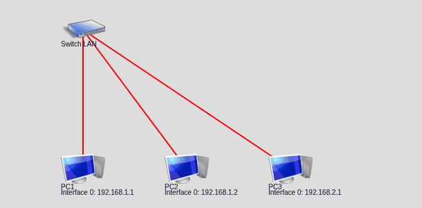

**Etape 3 :** Calculer l'adresse réseau de chaque ordinateur

Remplir le tableau suivant en effectuant l'opération ET logique entre l'adresse IP et le masque :

| Machine | Adresse IP | Masque réseau | Adresse réseau (à calculer) |
|---------|-----------|---------------|---------------------------|
| PC1 | `192.168.1.1` | `255.255.255.0` | `___.___.___.___ ` |
| PC2 | `192.168.1.2` | `255.255.255.0` | `___.___.___.___ ` |
| PC3 | `192.168.2.1` | `255.255.255.0` | `___.___.___.___ ` |

> **Aide** : Appliquez le ET logique octet par octet. Par exemple : `192 AND 255 = 192`, `1 AND 0 = 0`.

**Etape 4 :** Tester la connectivité

Sélectionner l'ordinateur source, cliquer sur **Network diagnostics**, saisir l'adresse de destination puis cliquer sur **Ping**. Le message le plus récent s'affiche en haut :

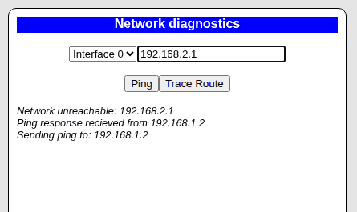

| Message de Netsim | Signification |
|-------------------|---------------|
| `Sending ping to: …` | Le ping est envoyé |
| `Ping response recieved from …` | La réponse est arrivée : le ping a réussi |
| `Sending ping to: …` sans réponse | Le ping est parti, mais la réponse n'est pas revenue |
| `Network unreachable: …` | L'ordinateur ne sait pas joindre cette adresse : le ping n'est pas envoyé |
| `Network not configured for interface: 0` | L'ordinateur n'a pas d'adresse IP |

Effectuer un ping entre chaque paire de machines :

| Test | Source | Destination | Résultat (succès/échec) | Message affiché |
|------|--------|------------|------------------------|-----------------|
| 1 | PC1 | PC2 | | |
| 2 | PC1 | PC3 | | |
| 3 | PC2 | PC3 | | |

**Etape 5 :** Changer le masque

1. Sur PC1 seulement, remplacer le masque par `255.255.0.0`, puis effectuer un ping de PC1 vers PC3.
2. Sur PC3, remplacer aussi le masque par `255.255.0.0`, puis refaire le ping de PC1 vers PC3.
3. **Remettre le masque `255.255.255.0` sur PC1 et PC3.**

| Test | Masque de PC1 | Masque de PC3 | Résultat du ping PC1 → PC3 |
|------|---------------|---------------|----------------------------|
| 1 | `255.255.0.0` | `255.255.255.0` | |
| 2 | `255.255.0.0` | `255.255.0.0` | |

### Questions

1. Quels pings fonctionnent à l'étape 4 ? Lesquels échouent ?
2. Comparez les adresses réseau des machines qui peuvent communiquer. Que remarquez-vous ?
3. Pourquoi PC3 ne peut-il pas communiquer avec PC1 et PC2, alors qu'ils sont tous connectés au même switch ?
4. A l'étape 5, pourquoi le premier ping part-il sans obtenir de réponse, alors que le second réussit ?

> **A retenir** : Le switch transmet les trames au niveau 2 (liaison), mais la communication IP (niveau 3) nécessite que les machines soient dans le **même réseau logique**. Même si les machines sont physiquement connectées au même switch, elles ne peuvent pas communiquer directement si leurs adresses réseau sont différentes.

---

## Partie 2 - Configuration dynamique avec DHCP

### Objectif

Mettre en place un serveur DHCP pour attribuer automatiquement des adresses IP aux machines du réseau.

### Topologie réseau

```
    ┌──────────────────────────────────┐
    │            Switch LAN            │
    └──┬──────────────┬────────────┬───┘
       │              │            │
       │              │            │
  ┌────┴─────┐  ┌─────┴────┐  ┌────┴─────┐
  │ Serveur  │  │   PC1    │  │   PC2    │
  │  DHCP    │  │ (client  │  │ (client  │
  │192.168.  │  │  DHCP)   │  │  DHCP)   │
  │ 1.253/24 │  │          │  │          │
  └──────────┘  └──────────┘  └──────────┘
                 Adresse IP    Adresse IP
                 attribuée     attribuée
                 par DHCP      par DHCP
```

### Instructions

**Etape 1 :** Modifier la topologie

En partant de la partie 1, supprimer PC3 (**Delete element**) et ajouter un serveur DHCP, nommé `Serveur DHCP`. Connecter le serveur DHCP au switch.

**Etape 2 :** Configurer le serveur DHCP

Sélectionner le serveur DHCP :

1. **Edit IP Info - Interface 0** : configurer l'adresse IP `192.168.1.253` avec le masque `255.255.255.0`
2. **Edit DHCP server info** : configurer la plage d'adresses à distribuer :
   - **Initial** : `10` (première adresse distribuable : 192.168.1.10)
   - **Final** : `50` (dernière adresse distribuable : 192.168.1.50)
   - Laisser **Gateway**, **DNS 1** et **DNS 2** vides pour l'instant.

   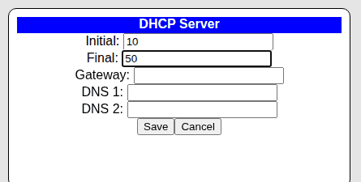

> **Explication** : Le serveur DHCP va distribuer des adresses IP comprises entre `192.168.1.10` et `192.168.1.50` aux machines qui en font la demande. Il distribue aussi son propre masque.

**Etape 3 :** Demander une adresse IP via DHCP

Cliquer deux ou trois fois sur **Slow** pour suivre les messages. Sélectionner PC1 et cliquer sur **Request DHCP info**. Mettre en pause (**Play/Pause**) pour lire les enveloppes :

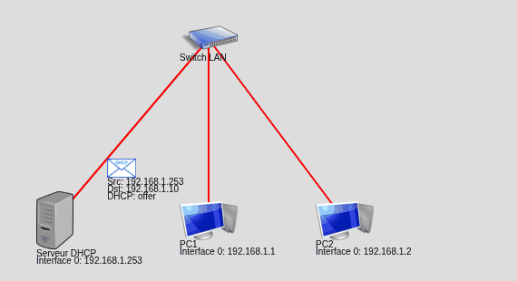

| Message | Src (source) | Dst (destination) |
|---------|--------------|-------------------|
| `DHCP: request` | | |
| `DHCP: offer` | | |

Relancer l'animation (**Play/Pause**), puis faire la même demande sur PC2.

**Etape 4 :** Vérifier la configuration

Vérifier les informations IP attribuées à chaque ordinateur via **Edit IP Info - Interface 0** (fermer avec **Cancel**).

Vous devez obtenir le résultat suivant :

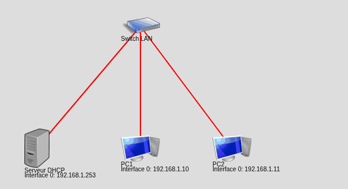

**Etape 5 :** Vérifier avec un ping de PC1 vers l'adresse de PC2, puis refaire **Request DHCP info** sur PC1.

### Questions

1. Quelles adresses IP ont été attribuées à PC1 et à PC2 ?
2. Ces adresses font-elles bien partie de la plage configurée sur le serveur DHCP ?
3. Quelles sont les adresses source et destination du message `DHCP: request` ? Expliquez-les.
4. L'adresse de PC1 a-t-elle changé après la deuxième demande ? Pourquoi ?
5. Quel est l'avantage d'utiliser DHCP plutôt que de configurer manuellement chaque machine ?
6. Pourquoi l'adresse du serveur DHCP (`192.168.1.253`) est-elle en dehors de la plage distribuée ?

---

## Partie 3 - Interconnexion de deux sous-réseaux

### Objectif

Comprendre le rôle du routeur et de la passerelle par défaut pour permettre la communication entre deux réseaux différents.

### Topologie réseau

```
                     ┌──────────┐
                     │ Routeur  │
                     │          │
                     │ if 0:    │
                     │192.168.  │
                     │ 1.254/24 │
                     │          │
                     │ if 1:    │
                     │192.168.  │
                     │ 2.254/24 │
                     └──┬───┬───┘
                        │   │
        interface 0 ────┘   └────── interface 1
                │                     │
    ┌───────────┴──────────┐    ┌─────┴──────┐
    │      Switch LAN      │    │   Switch   │
    │                      │    │  serveurs  │
    └─┬────────┬────────┬──┘    └─────┬──────┘
      │        │        │             │
 ┌────┴──┐┌────┴──┐┌────┴──┐     ┌────┴─────┐
 │Serveur││  PC1  ││  PC2  │     │   PC3    │
 │ DHCP  ││       ││       │     │(console) │
 │192.168││client ││client │     │192.168.  │
 │.1.253 ││ DHCP  ││ DHCP  │     │  2.1/24  │
 └───────┘└───────┘└───────┘     └──────────┘

 Réseau 192.168.1.0/24          Réseau 192.168.2.0/24
```

### Instructions

> **Attention** : sauvegarder avant de commencer (**Save**). Configurer **les deux interfaces** du routeur (étape 3) avant tout test : sinon, un ping qui passe par le routeur reste sans réponse.

**Etape 1 :** En conservant la configuration de la partie 2, ajouter les éléments suivants :

- 1 routeur : `Routeur`
- 1 switch supplémentaire : `Switch serveurs`
- 1 ordinateur : `PC3` (la console)

Connecter les éléments comme suit :
- Le **routeur, interface 0** → `Switch LAN`
- Le **routeur, interface 1** → `Switch serveurs`
- **PC3** → `Switch serveurs`

**Etape 2 :** Configurer PC3 (console)

Configurer PC3 via **Edit IP Info - Interface 0** :
- Adresse IP : `192.168.2.1`
- Masque : `255.255.255.0`

**Etape 3 :** Configurer le routeur

Le routeur a deux interfaces. Chaque interface doit avoir une adresse IP appartenant au réseau auquel elle est connectée.

> **Rappel** : Par convention, on attribue souvent au routeur la dernière adresse utilisable du réseau (ex: `.254`).

Sélectionner le routeur et configurer (**Edit IP Info - interface 0**, puis **Edit IP Info - interface 1**) :

| Interface | Réseau connecté | Adresse IP | Masque |
|-----------|----------------|-----------|--------|
| interface 0 | Réseau 192.168.1.0/24 | `192.168.1.254` | `255.255.255.0` |
| interface 1 | Réseau 192.168.2.0/24 | `192.168.2.254` | `255.255.255.0` |

**Etape 4 :** Désactiver le NAT du routeur

Sélectionner le routeur, cliquer sur **Edit NAT table**, **décocher** « Gateway mode (uses NAT) », puis **Save**.

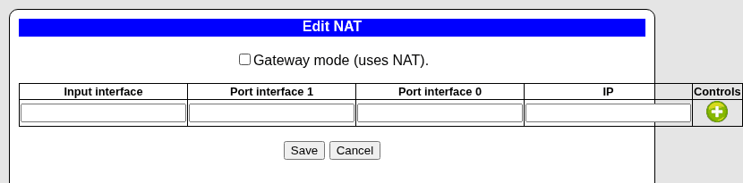

> **Explication** : le NAT remplace l'adresse source des paquets par celle du routeur, comme le fait une box Internet. Ici, les deux réseaux sont privés et doivent se joindre dans les deux sens : le routeur doit seulement **router**. Dans Netsim, le NAT est activé par défaut sur un nouveau routeur.

Vous devez obtenir le résultat suivant :

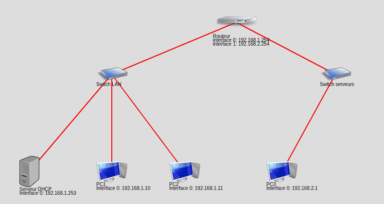

### Questions intermédiaires

1. Pourquoi le routeur a-t-il besoin de deux adresses IP ?
2. Pourquoi l'adresse de l'interface 0 du routeur doit-elle être dans le réseau 192.168.1.0/24 ?

**Etape 5 :** Premier test, sans passerelle

Effectuer un ping de PC1 vers PC3 (`192.168.2.1`) et noter le message : ____________________

**Etape 6 :** Configurer la passerelle par défaut sur le serveur DHCP

Sélectionner le serveur DHCP, puis **Edit DHCP server info** et configurer :
- **Gateway** : `192.168.1.254` (adresse de l'interface 0 du routeur)

> **Explication** : Le serveur DHCP va maintenant distribuer non seulement une adresse IP, mais aussi l'adresse de la passerelle par défaut. Ainsi, les machines du réseau 192.168.1.0 sauront vers quel équipement envoyer les paquets destinés à d'autres réseaux.

**Etape 7 :** Recharger la configuration DHCP

Sur PC1 et PC2, cliquer sur **Request DHCP info** pour obtenir la nouvelle configuration incluant la passerelle.

Vérifier que PC1 et PC2 ont bien reçu :
- Une adresse IP dans la plage 192.168.1.10 - 192.168.1.50 (**Edit IP Info - Interface 0**)
- La passerelle par défaut `192.168.1.254` (**Edit Gateways**, sur la ligne `0.0.0.0`)

**Etape 8 :** Deuxième test, avec la passerelle d'un seul côté

| Test | Source | Destination | Message affiché |
|------|--------|------------|-----------------|
| 1 | PC1 | PC3 (`192.168.2.1`) | |
| 2 | PC3 | PC1 | |

**Etape 9 :** Configurer la passerelle par défaut sur PC3

PC3 est configuré manuellement (pas de DHCP dans son réseau). Il faut donc configurer sa passerelle manuellement.

Sélectionner PC3, puis **Edit Gateways** et saisir :
- Network : `0.0.0.0`
- Mask : `0.0.0.0`
- Gateway : `192.168.2.254` (adresse de l'interface 1 du routeur)

Cliquer sur **[+]**, **puis** sur **Save** :

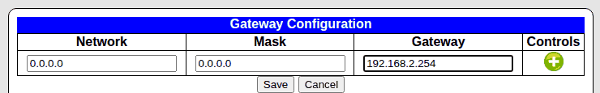

> **Explication** : La route `0.0.0.0 / 0.0.0.0` est appelée **route par défaut**. Elle signifie "pour toute destination inconnue, envoyer au routeur 192.168.2.254".

**Etape 10 :** Tester la connectivité inter-réseaux

Effectuer les tests de ping suivants :

| Test | Source | Destination | Résultat attendu | Résultat obtenu |
|------|--------|------------|-----------------|-----------------|
| 1 | PC1 | PC2 | Succès (même réseau) | |
| 2 | PC1 | PC3 (192.168.2.1) | Succès (via routeur) | |
| 3 | PC3 | PC1 | Succès (via routeur) | |

Puis, depuis PC1, dans **Network diagnostics**, lancer un **Trace Route** vers `192.168.2.1` et noter les adresses dans l'ordre :

| N° | Adresse |
|----|---------|
| 1 | |
| 2 | |

### Questions

1. Comparez avec la partie 1 : pourquoi le ping entre les réseaux 192.168.1.0 et 192.168.2.0 fonctionne-t-il maintenant ?
2. Quel est le chemin parcouru par un paquet ping envoyé de PC1 vers PC3 ? Décrivez les équipements traversés.
3. A l'étape 8, pourquoi le ping de PC1 vers PC3 part-il sans obtenir de réponse ?
4. Quels équipements traversés n'apparaissent pas dans le Trace Route ? Pourquoi ?

> **Remarque** : dans Netsim, un ping de PC1 vers l'interface la plus éloignée du routeur (`192.168.2.254`) reste sans réponse. C'est une limite du simulateur : un vrai routeur répond.

---

## Partie 4 - Résolution de noms avec DNS

### Objectif

Mettre en place un serveur DNS pour permettre la résolution de noms de domaine en adresses IP, et configurer le réseau pour que les machines utilisent ce serveur DNS automatiquement via DHCP.

### Topologie réseau

```
                     ┌──────────┐
                     │ Routeur  │
                     │          │
                     │ if 0:    │
                     │192.168.  │
                     │ 1.254/24 │
                     │          │
                     │ if 1:    │
                     │192.168.  │
                     │ 2.254/24 │
                     └──┬───┬───┘
                        │   │
        interface 0 ────┘   └────── interface 1
                │                          │
    ┌───────────┴──────────┐    ┌──────────┴───────────┐
    │      Switch LAN      │    │   Switch serveurs    │
    │                      │    │                      │
    └─┬────────┬────────┬──┘    └──┬───────────┬───────┘
      │        │        │          │           │
 ┌────┴──┐┌────┴──┐┌────┴──┐  ┌────┴─────┐┌────┴─────┐
 │Serveur││  PC1  ││  PC2  │  │   PC3    ││ Serveur  │
 │ DHCP  ││       ││       │  │(console) ││   DNS    │
 │192.168││client ││client │  │192.168.  ││192.168.  │
 │.1.253 ││ DHCP  ││ DHCP  │  │  2.1/24  ││2.253/24  │
 └───────┘└───────┘└───────┘  └──────────┘└──────────┘

 Réseau 192.168.1.0/24          Réseau 192.168.2.0/24
```

### Instructions

**Etape 1 :** En conservant la configuration de la partie 3, ajouter un **serveur DNS**, nommé `Serveur DNS`, et le connecter au `Switch serveurs`.

**Etape 2 :** Configurer le serveur DNS

Sélectionner le serveur DNS et configurer :

1. **Edit IP Info - Interface 0** : configurer l'adresse IP et le masque :
   - Adresse IP : `192.168.2.253`
   - Masque : `255.255.255.0`

2. **Edit Gateways** : configurer la passerelle par défaut, cliquer sur **[+]**, puis **Save** :
   - Network : `0.0.0.0`
   - Mask : `0.0.0.0`
   - Gateway : `192.168.2.254` (adresse de l'interface 1 du routeur)

Vous devez obtenir le résultat suivant :

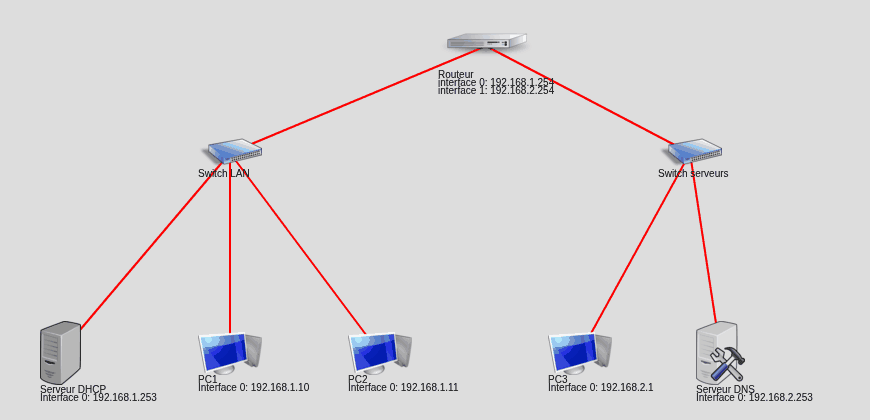

**Etape 3 :** Tester la connectivité avec le serveur DNS

Avant d'aller plus loin, vérifier que le serveur DNS est bien joignable depuis le réseau LAN.

Depuis PC1, effectuer un ping vers `192.168.2.253`.

> **Remarque** : Ce ping transite par le routeur car les deux machines appartiennent à des réseaux différents. S'il échoue, vérifier la passerelle par défaut de PC1, celle du serveur DNS et la configuration du routeur.

**Etape 4 :** Ajouter un enregistrement DNS

Sélectionner le serveur DNS, cliquer sur **DNS server config** et saisir l'entrée suivante, puis **[+]** et **Save** (laisser **Forwarder** vide) :

| Domain | IP |
|---------------|-----------|
| `console.netsim.lan` | `192.168.2.1` |

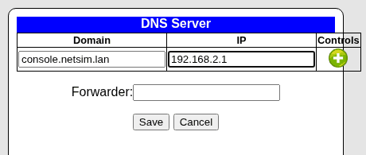

> **Explication** : Cet enregistrement de type A associe le nom `console.netsim.lan` à l'adresse IP `192.168.2.1` (PC3). Les machines qui interrogeront ce serveur DNS pourront ainsi utiliser ce nom à la place de l'adresse IP.

**Etape 5 :** Configurer le serveur DHCP pour distribuer l'adresse du DNS

Sélectionner le serveur DHCP, cliquer sur **Edit DHCP server info** et configurer :

- **DNS 1** : `192.168.2.253`

> **Explication** : Le serveur DHCP va désormais distribuer l'adresse du serveur DNS en plus de l'adresse IP et de la passerelle. Les machines obtiendront ainsi automatiquement la configuration DNS.

**Etape 6 :** Recharger la configuration DHCP

Sur PC1 et PC2, cliquer sur **Request DHCP info** pour obtenir la nouvelle configuration incluant le serveur DNS.

**Etape 7 :** Vérifier la configuration reçue par PC1

| Paramètre | Où le lire | Valeur attendue |
|-----------|------------|----------------|
| Adresse IP | **Edit IP Info - Interface 0** | dans la plage `192.168.1.10` – `192.168.1.50` |
| Masque | **Edit IP Info - Interface 0** | `255.255.255.0` |
| DNS 1 | **Edit IP Info - Interface 0** | `192.168.2.253` |
| Passerelle | **Edit Gateways** | `192.168.1.254` |

**Etape 8 :** Ping par nom de domaine, sans résolution

Depuis PC1, dans **Network diagnostics**, effectuer un ping vers `console.netsim.lan` et noter le message : ____________________

**Etape 9 :** Résoudre un nom de domaine

Sélectionner PC1, cliquer sur **DNS lookup**, saisir `console.netsim.lan` puis cliquer sur **Lookup**. Observer les deux enveloppes DNS (utiliser **Slow** et **Play/Pause**) :

| Message | Src (source) | Dst (destination) |
|---------|--------------|-------------------|
| `Lookup: console.netsim.lan` | | |
| `Response: …` | | |

> **Explication** : PC1 envoie une requête DNS au serveur `192.168.2.253` pour obtenir l'adresse IP correspondant au nom `console.netsim.lan`. Le serveur répond avec l'adresse `192.168.2.1`, que PC1 garde dans son cache DNS.

**Etape 10 :** Ping par nom de domaine

Depuis PC1, refaire le ping vers `console.netsim.lan` et noter l'adresse affichée : ____________________

> **Explication** : PC1 trouve maintenant l'adresse dans son cache DNS, puis envoie le ping vers cette adresse. **Simplification de Netsim** : il faut faire soi-même le **DNS lookup** avant d'utiliser un nom. Sur une vraie machine, cette résolution est automatique.

### Questions

1. Quelle est la différence entre un ping vers `192.168.2.1` et un ping vers `console.netsim.lan` ? Quelles étapes supplémentaires interviennent dans le second cas ?
2. PC2 peut-il effectuer un ping vers `console.netsim.lan` sans faire de **DNS lookup** ? Faire l'essai et expliquer.
3. Pourquoi le serveur DNS est-il placé dans le réseau `192.168.2.0/24` et non dans le réseau `192.168.1.0/24` ? Y aurait-il un inconvénient à le placer dans le réseau LAN ?
4. Que se passerait-il si le routeur était en panne et qu'un ordinateur du réseau LAN tentait de résoudre `console.netsim.lan` ?

> **A retenir** : Le DNS (Domain Name System) est le service qui traduit les noms de domaine lisibles par l'humain (comme `console.netsim.lan`) en adresses IP utilisables par les machines. Sans DNS, il faudrait connaître et saisir l'adresse IP de chaque machine que l'on souhaite contacter.

---

## Partie 5 - Serveur web et virtual hosts

### Objectif

Mettre en place un serveur web dans le réseau "serveurs", y publier une page HTML, et y accéder depuis le réseau LAN en utilisant un nom de domaine. En exercice final, configurer un second site (virtual host) de manière autonome.

### Topologie réseau

```
                     ┌──────────┐
                     │ Routeur  │
                     │          │
                     │ if 0:    │
                     │192.168.  │
                     │ 1.254/24 │
                     │          │
                     │ if 1:    │
                     │192.168.  │
                     │ 2.254/24 │
                     └──┬───┬───┘
                        │   │
        interface 0 ────┘   └────── interface 1
                │                           │
    ┌───────────┴──────────┐   ┌────────────┴────────────┐
    │      Switch LAN      │   │     Switch serveurs     │
    │                      │   │                         │
    └─┬────────┬────────┬──┘   └──┬─────────┬─────────┬──┘
      │        │        │         │         │         │
 ┌────┴──┐┌────┴──┐┌────┴──┐ ┌────┴───┐┌────┴───┐┌────┴───┐
 │Serveur││  PC1  ││  PC2  │ │  PC3   ││Serveur ││Serveur │
 │ DHCP  ││       ││       │ │console ││  DNS   ││  web   │
 │192.168││client ││client │ │192.168.││192.168.││192.168.│
 │.1.253 ││ DHCP  ││ DHCP  │ │ 2.1/24 ││2.253/24││2.252/24│
 └───────┘└───────┘└───────┘ └────────┘└────────┘└────────┘

 Réseau 192.168.1.0/24          Réseau 192.168.2.0/24
```

### Instructions

**Etape 1 :** En conservant la configuration de la partie 4, ajouter un **serveur web**, nommé `Serveur web`, et le connecter au `Switch serveurs`.

**Etape 2 :** Configurer le serveur web

Sélectionner le serveur web et configurer :

1. **Edit IP Info - Interface 0** :
   - Adresse IP : `192.168.2.252`
   - Masque : `255.255.255.0`

2. **Edit Gateways** (puis **[+]** et **Save**) :
   - Network : `0.0.0.0`
   - Mask : `0.0.0.0`
   - Gateway : `192.168.2.254`

Vous devez obtenir le résultat suivant :

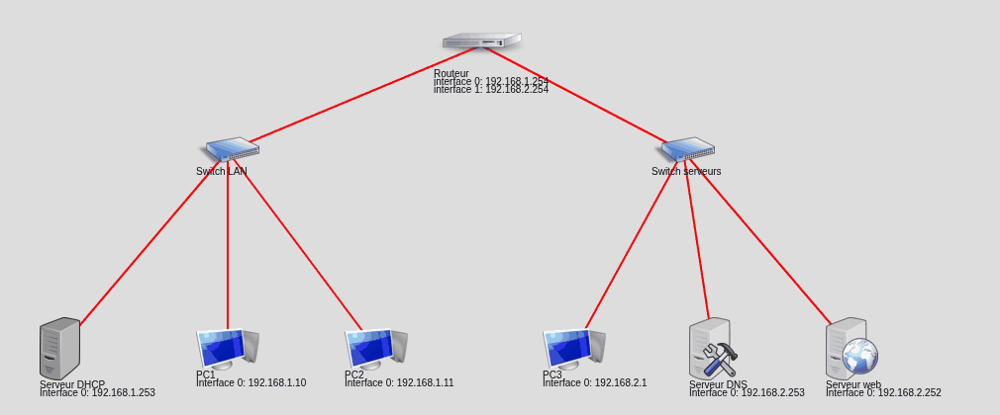

**Etape 3 :** Tester la connectivité avec le serveur web

Depuis PC1, effectuer un ping vers `192.168.2.252`.

> **Remarque** : Si le ping échoue, vérifier que la passerelle de PC1 est bien `192.168.1.254`, que le serveur web a une passerelle et que le routeur est correctement configuré.

**Etape 4 :** Ajouter l'enregistrement DNS du serveur web

Sélectionner le serveur DNS, cliquer sur **DNS server config** et ajouter l'entrée suivante (**[+]**, puis **Save**) :

| Domain | IP |
|---------------|-----------|
| `www.netsim.lan` | `192.168.2.252` |

**Etape 5 :** Résoudre le nom depuis PC1

Depuis PC1, effectuer un **DNS lookup** de `www.netsim.lan`. Le serveur DNS doit répondre `192.168.2.252`.

**Etape 6 :** Ping par nom de domaine

Depuis PC1, effectuer un ping vers `www.netsim.lan`. L'adresse affichée doit être `192.168.2.252`.

**Etape 7 :** Configurer le virtual host sur le serveur web

Sélectionner le serveur web et cliquer sur **Edit HTTP server info** :

1. Dans la colonne **Domain**, saisir `www.netsim.lan` puis cliquer sur **[+]** pour créer le virtual host.

   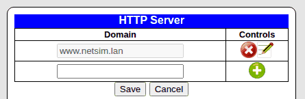

2. Cliquer sur l'icône **Edit** (crayon) de la ligne `www.netsim.lan` pour accéder à la gestion des fichiers.
3. Dans la colonne **File**, saisir `index.html` puis cliquer sur **[+]**.

   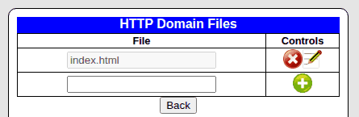

4. Cliquer sur l'icône **Edit** de la ligne `index.html` pour ouvrir l'éditeur, puis saisir le code HTML suivant :

   ```html
   <!DOCTYPE html>
   <html>
   <head><title>Netsim</title></head>
   <body>
     <h1>Hello World</h1>
   </body>
   </html>
   ```

   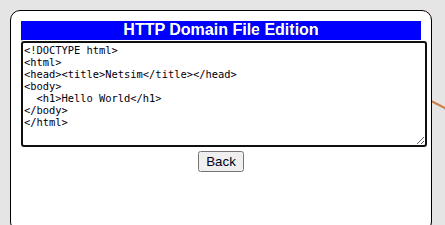

5. Cliquer sur **Back** (retour aux fichiers), encore sur **Back** (retour aux domaines), **puis sur Save**. Sans ce dernier **Save**, le site n'est pas enregistré.

**Etape 8 :** Accéder au site web depuis PC1

Sélectionner PC1 et cliquer sur **Web browser (HTTP client)**. Saisir l'URL, sans `http://` :

```
www.netsim.lan/index.html
```

Cliquer sur la flèche verte. La page "Hello World" doit s'afficher dans le navigateur du simulateur :

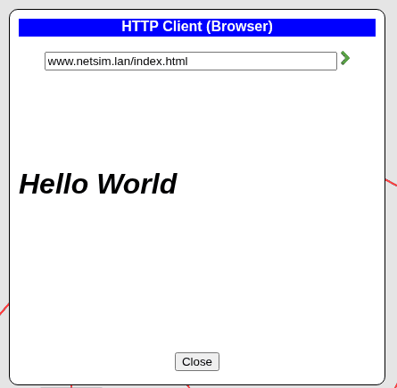

| Message du navigateur | Cause |
|-----------------------|-------|
| `Domain not in local DNS cache. Look up first.` | Faire d'abord un **DNS lookup** du nom (ou le nom est faux) |
| `Malformed URL.` | L'URL doit être de la forme `nom/fichier` ou `adresse IP/fichier` |
| `404 - Not found` | Le serveur a répondu, mais le virtual host ou le fichier n'existe pas |
| `Loading...` qui ne finit pas | Le serveur web est injoignable : vérifier le ping |

**Etape 9 :** Provoquer des erreurs

Depuis PC1, saisir les URL suivantes et noter le résultat :

| URL | Résultat |
|-----|----------|
| `www.netsim.lan` | |
| `www.netsim.lan/accueil.html` | |
| `192.168.2.252/index.html` | |

---

### Exercice final (autonome)

Vous devez maintenant configurer un second site web de manière autonome. L'objectif est de publier un fichier `status.json` accessible à l'adresse `api.netsim.lan/status.json`, contenant le JSON suivant :

```json
{ "status": "running" }
```

**Contrainte** : `api.netsim.lan` doit être un virtual host distinct de `www.netsim.lan` sur le même serveur web.

Rédiger ci-dessous la démarche complète en détaillant chaque étape :

| Etape | Action | Détail |
|-------|--------|--------|
| 1 | | |
| 2 | | |
| 3 | | |
| 4 | | |
| 5 | | |
| 6 | | |

> **Questions de réflexion** :
> 1. Pourquoi est-il nécessaire de créer un virtual host séparé plutôt que d'ajouter `status.json` directement dans le virtual host `www.netsim.lan` ?
> 2. Les noms `www.netsim.lan` et `api.netsim.lan` ont la même adresse IP. Comment le serveur web sait-il quel site envoyer ?
> 3. Que faudrait-il modifier si le serveur web était remplacé par une machine d'adresse IP `192.168.2.251` ? Lister tous les éléments à reconfigurer.

---

## Activités complémentaires

### Tester la connexion réseau réelle

Ouvrez un terminal sur votre machine (réelle, pas le simulateur) et exécutez :

```bash
ping 8.8.8.8
ping www.google.com
```

Sous Linux et macOS, `ping` ne s'arrête pas tout seul : l'arrêter avec Ctrl + C, ou limiter le nombre d'envois (`ping -c 3 8.8.8.8`).

Exemple de résultat attendu :

```
PING 8.8.8.8 (8.8.8.8) 56(84) bytes of data.
64 octets de 8.8.8.8 : icmp_seq=1 ttl=113 temps=164 ms
64 octets de 8.8.8.8 : icmp_seq=2 ttl=113 temps=130 ms
64 octets de 8.8.8.8 : icmp_seq=3 ttl=113 temps=134 ms

--- statistiques ping 8.8.8.8 ---
3 paquets transmis, 3 reçus, 0 % paquets perdus, temps 2003 ms
rtt min/moy/max/mdev = 130,331/142,799/164,374/15,317 ms
```

> **Explication** :
> - `8.8.8.8` est le serveur DNS public de Google
> - `icmp_seq` : numéro de séquence du paquet ICMP
> - `ttl` (Time To Live) : nombre de routeurs maximum que le paquet peut encore traverser
> - `temps` : temps d'aller-retour (RTT - Round Trip Time) en millisecondes
> - `0 % paquets perdus` : tous les paquets sont arrivés à destination

### Informations sur un nom de domaine (WHOIS)

Le service WHOIS permet de consulter les informations d'enregistrement d'un nom de domaine (propriétaire, date de création, serveurs DNS, etc.).

Rendez-vous sur : [https://who.is/](https://who.is/)

Recherchez les informations sur un nom de domaine de votre choix et identifiez :
- La date de création du domaine
- La date d'expiration
- Les serveurs DNS associés

### Vérifier vos informations personnelles

Le site **Have I Been Pwned** permet de vérifier si votre adresse email a été compromise dans une fuite de données connue.

Rendez-vous sur : [https://haveibeenpwned.com/](https://haveibeenpwned.com/)

> **Attention** : Si votre adresse email apparaît dans une fuite, il est recommandé de changer votre mot de passe sur les services concernés et d'activer l'authentification à deux facteurs (2FA) lorsque c'est possible.

---

## Bilan

A l'issue de ce TP, vous avez appris à :

| Concept | Description |
|---------|-------------|
| **Adressage IP statique** | Configurer manuellement une adresse IP et un masque sur une machine |
| **Adresse réseau** | Calculer l'adresse réseau par un ET logique entre IP et masque |
| **Communication locale** | Deux machines communiquent directement si elles sont dans le même réseau |
| **DHCP** | Attribuer automatiquement des adresses IP via un serveur DHCP |
| **Routage** | Utiliser un routeur pour interconnecter deux réseaux différents |
| **Passerelle par défaut** | Configurer l'adresse du routeur comme gateway pour atteindre d'autres réseaux |
| **DNS** | Résoudre des noms de domaine en adresses IP via un serveur DNS |
| **Serveur web** | Héberger des pages HTML accessibles par nom de domaine depuis un autre réseau |
| **Virtual host** | Héberger plusieurs sites distincts sur un même serveur web en les différenciant par leur nom de domaine |
